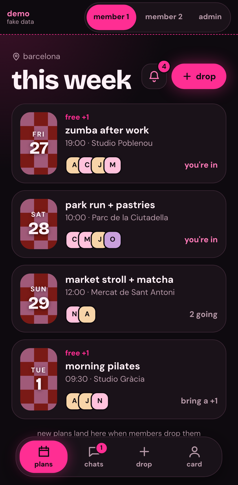
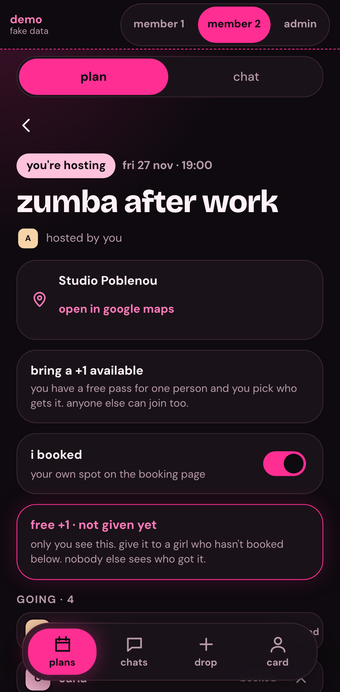
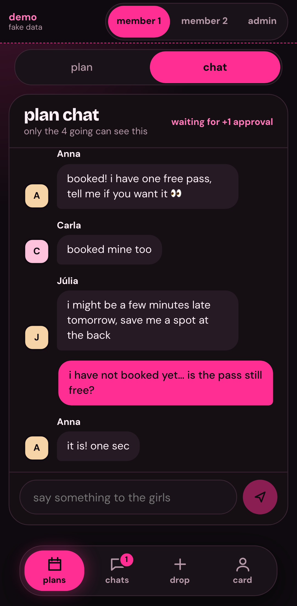
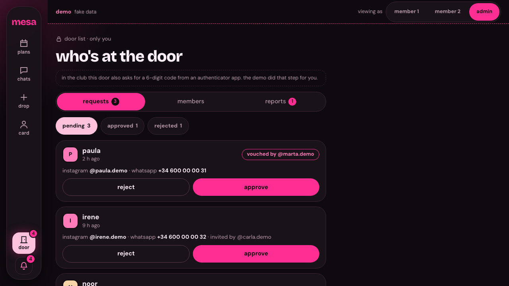
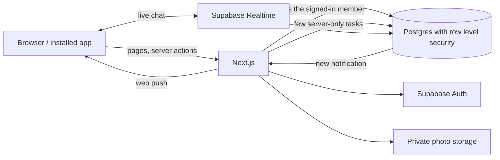

# mesa

A private community web app for organising group outings in Barcelona: classes, runs, walks, matcha, anything. Members join by invitation, post plans, join each other's plans and chat. It installs to a phone's home screen like an app.

## Live demo

**[Try it: mesabcn.com/demo](https://mesabcn.com/demo)**: one click, no sign-up. All people and plans are made up and start fresh every night.

| be | what to try |
|---|---|
| **member 1** | read the chat on "zumba after work", vote for plans after, join another plan |
| **member 2** | host: give member 1 the free +1, drop, edit or cancel a plan |
| **admin** | approve a request, open the one-time link and join as her, look at members and reports |

Switch between them at any time with the bar at the top.

| | | |
|---|---|---|
|  |  |  |



## Features

- **Membership:** request an invite, approval by an admin, personal one-time invite links, login with WhatsApp number and password.
- **Plans:** post an outing with time, place, optional maps and booking links; join and leave; host tools (edit, cancel, share, remove a member).
- **Booking and +1:** members mark themselves booked; a host with a free +1 gives it to one joined member.
- **Chat:** a realtime chat for each plan, for the people going.
- **Poll:** "plans after" vote with a few preset options and custom ones.
- **Safety:** report and block members.
- **Notifications:** in-app inbox and web push.
- **Admin:** a door list for requests, members and reports, protected by two-step sign-in.
- **Profiles:** a member card with photo, area, where she trains, what she likes and a short bio.

## How it fits together



The database is the security boundary: every table has row level security, writes go through checked functions, and the rules are tested as each kind of caller. The interface only reflects what the database already allows.

## Tech stack

- Next.js (App Router) and TypeScript
- Supabase (Postgres, Auth, Realtime, Storage)
- Plain CSS with CSS Modules
- Web Push, installable PWA
- Vitest for tests

## Getting started

Requirements: Node 22 and Docker Desktop.

```bash
npm install
npx supabase start -x imgproxy,studio,edge-runtime,vector,logflare,mailpit,postgres-meta
cp .env.example .env.local     # fill in the values printed by: npx supabase status -o env
node scripts/vapid.mjs         # prints the web push keys; add them to .env.local
npm run seed                   # sample admin, members and requests
npm run dev
```

The seed creates a sample admin (`+34600000001`) and members; their password is `mesa-dev-password`. The first visit to the door list asks the admin to set up an authenticator app.

## Environment variables

Copy `.env.example` to `.env.local`. Never commit real values.

| Variable | Purpose |
|---|---|
| `NEXT_PUBLIC_SITE_URL` | public address of the app (used in invite links) |
| `NEXT_PUBLIC_SUPABASE_URL` | Supabase project URL |
| `NEXT_PUBLIC_SUPABASE_ANON_KEY` | Supabase public key |
| `SUPABASE_SERVICE_ROLE_KEY` | Supabase service key (server only) |
| `NEXT_PUBLIC_VAPID_PUBLIC_KEY` | web push public key |
| `VAPID_PRIVATE_KEY` | web push private key (server only) |
| `VAPID_SUBJECT` | contact address sent with push requests |
| `PUSH_WEBHOOK_SECRET` | shared secret for the push endpoint (server only) |
| `DEMO_MODE` | `true` turns on the public demo (also needs `demo_config.enabled` in the database) |

## Scripts

| Command | What it does |
|---|---|
| `npm run dev` | start the app in development |
| `npm run build` / `npm start` | production build and start |
| `npm run check` | lint, type-check and unit tests |
| `npm run test:db` | database and security tests (needs the local Supabase) |
| `npm run test:e2e` | browser tests with Playwright (needs the local Supabase) |
| `npm run seed` | sample data for development |
| `npm run door -- list \| reports \| approve <+e164> \| resend <+e164>` | terminal version of the admin door list |
| `node scripts/create-admin.mjs` | create an admin account |
| `node scripts/set-push-config.mjs <url>` | set where the database sends push hand-offs |
| `node scripts/reset-admin-mfa.mjs` | remove an admin's authenticator |
| `node scripts/erase-member.mjs` | erase one person's data (requires `CONFIRM=erase`) |

## Project structure

```
src/app/             pages, server actions and route handlers
src/components/      UI components
src/lib/             shared helpers
src/server/          server-side logic (apply, join, login limits, push)
supabase/migrations/ database schema, policies, functions and triggers
tests/               unit tests; tests/db holds the integration and security tests
e2e/, e2e-demo/      browser tests for the app and for the demo
.claude/             project skills and the tester agent
scripts/             development and maintenance scripts
```

## Testing

```bash
npm run check      # lint, type-check, unit tests
npm run test:db    # runs against the local Supabase
npm run test:e2e   # real browser tests (app and demo), desktop and phone sizes (first time: npx playwright install chromium)
```

The database tests cover access rules for visitors, pending applicants, removed members, members and the admin (with and without two-step sign-in), invite links, chat, the +1, notifications, photos and the admin actions.

## How this is built

The app is developed with an AI coding assistant, inside guardrails that do not depend on trusting it:

- **Written rules** the assistant reads (`CLAUDE.md`), and task playbooks in `.claude/skills/` (database changes, access-rule tests, privacy review, browser tests, shipping).
- **Tests first for security:** a failing test for the visitor, removed member, other member and admin cases, then the change.
- **An independent tester agent** (`.claude/agents/qa-tester.md`) that gets only the "done when" list, hunts for regressions and privacy leaks, and reports evidence or "not verified".
- **Protected `main`:** pull requests only, with lint, types, unit, database, browser, build, audit and migration-history checks required.

Examples of what this caught before release: a removed member's hidden handle becoming public on rejoin, a form error silently re-ticking a privacy switch, a card that failed to save although the database tests passed, and a live update that could be dropped.

## Privacy

Members never see each other's phone numbers; only the admin can. Instagram handles are private too: only the member and the admin see a handle, unless the member turns on "show my instagram on my card". Pages are not indexed by search engines.

## Planned

- Automated, encrypted database backups (see the TODO in `.github/workflows/keepalive.yml`).
- Privacy notice and consent line on the request form.
